# DeepSeek Agent · 鸿蒙手机版

这个仓库在 [Aoan2011/DeepSeek-Agent](https://github.com/Aoan2011/DeepSeek-Agent) 之上，
加了一层 **HarmonyOS NEXT 原生壳**：web 产物装进 ArkWeb 容器直接跑，不用虚拟机、不用 QEMU。

## 现在能做什么

签名包已经装到真机上跑通了 —— Mate 60 Pro（ALN-AL80，OpenHarmony 7.0.0，API 26，arm64）。

| 能力 | 状态 |
| --- | --- |
| 构建 / 签名 / 安装 | 通过（AGC 调试证书 + 调试 Profile） |
| 首屏渲染、深色跟随系统、横屏双栏 | 通过 |
| 对话、单工具、多工具链与后台任务 | 通过 |
| 工作区文件树、Monaco diff | 通过 |
| 导出下载到系统目录 | 通过 |
| 附件上传（图库 / 拍照 / 文件） | 通过 |
| 朗读（服务端 TTS 走 AudioContext） | 通过 |
| 原生通知 | 通过（ArkWeb 没有 Web Notification，走原生桥） |
| 账号登录 | OAuth 流程已接通，待真机登录收尾 |

## 怎么构建

```sh
pnpm install
pnpm build:harmony          # 打包 web 产物并同步进 rawfile
```

然后用 DevEco Studio 打开 `harmony/`，或命令行：

```powershell
$env:DEVECO_SDK_HOME = 'C:\Program Files\Huawei\DevEco Studio\sdk'
hvigorw.bat assembleHap --mode module -p product=default -p buildMode=debug --no-daemon
```

签名材料放在 `~/.ohos/config/`，路径填进 `harmony/build-profile.json5` 的 `signingConfigs`（含密码，不提交）。

## 一键验收

```cmd
harmony\acceptance.cmd
```

14 项检查：HAP 体积、资源清单一致性、调试开关为空、安装启动、页面加载、无生命周期超时、二次冷启动、返回键。

## 手机上跑不了的

- **桌面端 `desktop/` 的 Python 桥** —— 手机上没有"本机"
- **浏览器扩展 `extension/`** —— 与壳无关
- **工作区本地文件夹** —— ArkWeb 的 `showDirectoryPicker` 会退化成文件选择器，壳里把它摘掉让 UI 诚实置灰

## 深入

- [HARMONY.md](HARMONY.md) —— 环境、构建、实测数据、踩过的坑、ArkWeb 能力表、调试开关
- [harmony/CHANGELOG.md](harmony/CHANGELOG.md) —— 为什么长这样：三个核心决定、按代价排序的坑、刻意没做的事

---

下面这份是上游 README，对 **web 版**仍然有效。

# DeepSeek Agent

[English](README.en.md) | 简体中文

[](https://github.com/Aoan2011/DeepSeek-Agent/actions/workflows/pages.yml)
[](https://github.com/Aoan2011/DeepSeek-Agent/actions/workflows/ci.yml)
[](https://python.org)
[](LICENSE)


在 [deepseek-ai/chat-demo](https://github.com/deepseek-ai/chat-demo) 基础上做的 Agent 化改造：把纯聊天前端变成能**调用工具、连接本机、读取网页、接入 MCP、预览工作区改动**的助手。界面沿用原有设计语言，新增的动效、卡片与面板都建立在同一套 token 上。

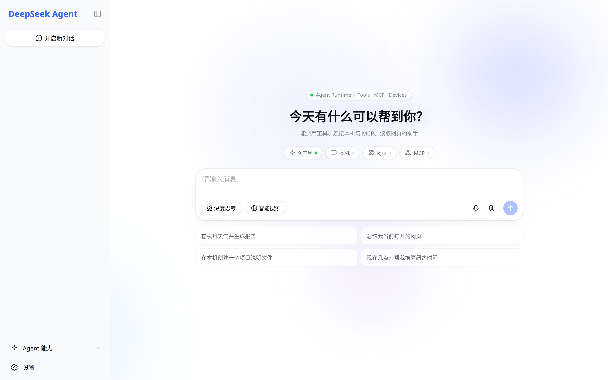

## 开发前言
### 相比[Aoan2011/One-Cedric](https://github.com/Aoan2011/One-Cedric)的能力差异
| 能力 | [One-Cedric](https://github.com/Aoan2011/One-Cedric) | [DeepSeek Agent](https://github.com/Aoan2011/DeepSeek-Agent) |
| --- | --- | --- |
| 语言 | Python | TypeScript + Python |
| 协议 | OpenAI Chat Completion | Anthropic & Reasponse API|
| 工具调用 | 桌面端 | 浏览器端 + 桌面端|
| 核心 | CLI | 浏览器前端 |
| 浏览器扩展 | 无 | 有 |
| 完善程度 | 实验性 | 可用 |
| 实用性 | 低 | 高 |

作者于 2026 年 11 月 14 日在[这篇文章](https://www.ithome.com/1/026/960.htm)上看到了最初的[deepseek-ai/chat-demo](https://github.com/deepseek-ai/chat-demo)，觉得非常有意思，就想fork一个下来。

## 相比原版新增的能力

| 能力 | 说明 |
| --- | --- |
| 工具调用循环 | 真实的多轮 `tool_use` / `tool_result` 往返，支持流式解析、最大轮次与中途停止 |
| 子 Agent | 主 Agent 可派生独立上下文的子 Agent，限定只读工具、单独轮次，只回传结论 |
| 主动提问 | 模型卡在选项上时可以停下来提问：输入框上方弹出选项卡片，回答作为 `tool_result` 回到本轮推理 |
| 可视化组件 | 模型自行决定把结果做成 widget，以沙箱 iframe 直接渲染在对话里，可展开与下载 |
| 电脑操作 | 桌面端提供截屏、鼠标移动/点击、键盘输入、窗口列表与聚焦，全部走审批 |
| Markdown 扩展 | 九色打底高亮、手写波浪线、GitHub README 的 `> [!IMPORTANT]` 等五种提示块 |
| 浏览器内置工具 | 时间日期、定位、天气、通知、剪贴板、网页抓取、文件产物读写等，无需任何后端 |
| 本地工具集 | 从 one_cedric 移植 26 个纯浏览器工具：计算、随机数、密码、哈希、编码、JSON / CSV、文本统计与相似度、cron、二维码等 |
| 用量与预算 | 侧栏底部按 DeepSeek 官网价估算花费，显示预算进度、今日用量、高峰 / 空闲时段与下一次切换倒计时 |
| 玻璃与性能 | 设置、Agent 能力、工作区用普通毛玻璃；侧栏、输入框、右侧导航恢复液态玻璃折射。输入框压缩到一行起步；设置里有 GitHub 仓库信息（星数来自公开 API，本地缓存一小时） |
| 浏览器扩展 | 读取当前网页、总结、点击输入、滚动、整页截图、标签页管理 |
| 桌面端（Python + rich） | 本机文件读写改删、命令执行、Python 执行、目录沙箱、本地 stdio MCP 桥接 |
| MCP 客户端 | 远程 Streamable HTTP / SSE 服务器，以及经桌面端桥接的本地 stdio 服务器 |
| 文件产物 | 工具产出的 Markdown / 图片 / JSON 等落库到 IndexedDB，可在对话里预览与下载 |
| 目标 | 目标跨轮次保留并注入系统提示；面板里新建 / 编辑 / 达成 / 放弃 / 重新激活，内置三套可改写的模板；Agent 也能用 `manage_goals` 自己维护 |
| 请求净化 | 工具结果里的孤立代理项与控制字符在发送前替换掉，截断不切断 emoji；服务端报 JSON 解析失败时自动去掉图片、缩短结果重试一次 |
| 权限与审批 | 写文件、执行命令、点击页面等危险操作默认确认；权限模式（默认权限 / 允许完全访问）放在输入框里，确认面板与提问面板同位置，页面在后台时用系统通知提醒 |
| 工具调用行 | 与搜索步骤同一套视觉：图标 + Agent 写的目的 + 状态 + 耗时，没有卡片外壳；文件改动显示 `+N −M`，点一下直接跳到该文件的 diff |
| 并行与后台 | 一轮最多同时跑 8 个工具（可调）；单个工具可「后台运行」，或超过 20 秒自动转后台，任务面板里看进度、取消、回传结果 |
| 自建工具 | Agent 可以把已有工具组合成新工具（只做编排，不生成代码），注册后当内置工具用 |
| 回答内预览 | `preview_file` 在回答底部渲染代码 / Markdown / HTML 网页 / 图片 / CSV 的预览 widget |
| 看图 | `view_image` 支持 base64、产物 id、远程地址，缩到长边 1568 内以图片块回传模型；扩展与桌面端截图同样会真正回传 |
| 工作区 | 内置演示仓库 + 任意多个本地文件夹，在输入框里选择当前使用哪一个；文件树按目录列出改动，点开就是逐行 diff |
| 精确 token | 底栏与草稿计数可切换到 DeepSeek 真实词表（BPE）逐 token 切分，词表按需懒加载 1.5MB，取不到时自动退回估算 |
| Git 分支 | 读取 `.git` 的分支与当前分支；演示仓库可切换、新建分支，基线与工作树整组替换 |
| Monaco diff | 懒加载 Monaco DiffEditor：删除行红底、新增行绿底，实时 `+N −M` 统计，可并排或行内 |
| 实时状态条 | 输入框下方每秒刷新输入 / 输出 token、首字延迟、缓存命中率、瞬时速度与用时，另有防抖 220ms 的草稿 token；只订阅运行状态切片，流式过程中不再整条重渲染。速度取最近 1.2s 的差分，停顿时落回 0，跑完显示整轮平均 |
| 上下文占用 | 输入框右下角的圆环按模型窗口折算本轮上下文的占用，超过 60% 变琥珀、85% 变红 |
| 液态玻璃 | 侧边栏、输入框与右侧问题导航用 canvas 位移贴图 + `backdrop-filter: url(#filter)` 做真实折射；设置、Agent 能力、工作区保持普通毛玻璃 |
| 渐进式模糊 | 对话顶部与输入框下方各叠一组渐变蒙版的模糊层，内容滚进标题栏或输入区时逐级虚化 |
| 问题导航 | 消息区右侧一列刻度对应每一条提问，当前读到哪条就亮哪条；常驻与输入框同一套液态玻璃，悬停展开成问题列表，点一下平滑滚到该条 |
| 运行时设置 | 设置里的「Agent」分组：工具调用开关、执行权限、最大步数、并行工具数、后台执行、token 统计、自定义提示词、温度与 Top P、演示模式 |
| 流式文字动画 | 新到的文字从偏下位置轻微上浮并解除高斯模糊，落位时回弹一下 |
| 模型选择 | 输入框底部一行显示「模型名 + 当前等级」；点开是模型行和推理等级卡片，模型列表支持远端 `/models` 拉取并缓存 |
| 后台任务 | 工具可转入后台，模型也能用 `task_status` 查看进度与输出、用 `task_cancel` 取消，不必等用户转述 |
| 思考强度 | 模型入口里是五档胶囊滑杆（关闭 / Low / High / Max / Ultra），真实下发 `reasoning_effort` 与思考预算，满档标题变成额度提示 |
| 视觉效果 | 极光背景、光标柔光、标题流光、消息入场、执行脉冲，并尊重「精简动效」设置 |
| 动效调节 | 设置里可调动画速度倍率（0.5×-2×），并逐项开关光斑 / 流光 / 过渡 / 脉冲；系统「减少动态效果」同样生效 |
| 多工作区 | 演示仓库与多个本地目录并列，句柄存 IndexedDB，刷新后按需重新授权 |

<table>
<tr>
<td width="50%">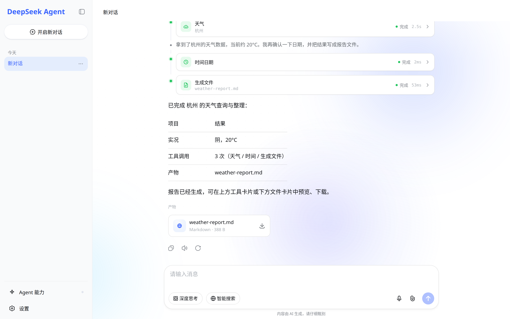</td>
<td width="50%">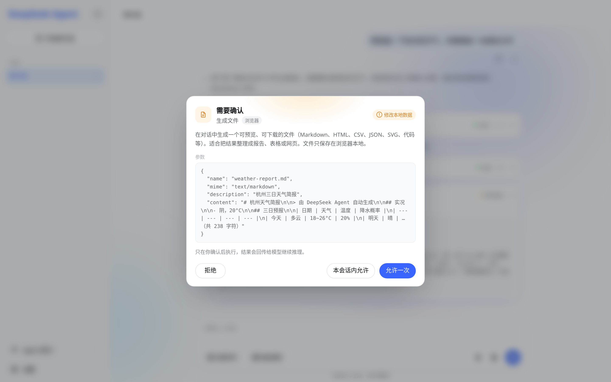</td>
</tr>
<tr>
<td align="center">工具调用卡片、执行耗时与文件产物</td>
<td align="center">写文件前的审批确认</td>
</tr>
</table>

## 快速开始

需要 Node.js 22.12+ 与 pnpm：

```sh
pnpm install
pnpm dev          # http://localhost:8090
```

首次打开会要求填写 API Key（保存在本机 localStorage）。想在没有 Key 的情况下体验完整工具链路，可在 **设置 → Agent** 打开「演示模式」，或直接执行：

```js
localStorage.setItem('chat-agent:mock-agent', 'true')
```

侧栏「工作区」或 `Ctrl/Cmd + Shift + E` 可打开工作区，内置演示仓库带三条分支与未提交改动，不需要任何本地环境。

演示模式使用本地脚本化模型，按问题自动选择剧本：天气与报告、桌面端写文件、MCP 笔记检索。它用来验证协议、审批、产物与渲染是否正常，不做真实推理；剧本依赖对应工具已经注册（例如 MCP 剧本需要先连上带 `notes_search` 的服务器）。

## 部署到 GitHub Pages

仓库自带 [`.github/workflows/pages.yml`](.github/workflows/pages.yml)：推送到 `main` 后自动执行类型检查、lint、构建并发布到 Pages。

部署到 **`aoan2011.github.io/DeepSeek-Agent`**（项目页，子路径 `/DeepSeek-Agent/`）：

1. 在 GitHub 新建仓库 `DeepSeek-Agent`（public，不要勾选初始化 README）；仓库已存在就跳过
2. 把远端指向新仓库并推送：

```sh
git remote set-url origin https://github.com/Aoan2011/DeepSeek-Agent.git
git push -u origin main
```

如果远端已经有一份无关的历史（例如初始化时建过 README，或之前推过别的版本），普通 push 会报 `non-fast-forward`。本仓库的历史是完整的，直接覆盖即可：

```sh
git push -f -u origin main
```

3. 打开 **Settings → Pages**，Source 选择 **GitHub Actions**
4. 等待 Actions 完成（会先跑 `pnpm type`、`pnpm lint` 再构建），访问 `https://aoan2011.github.io/DeepSeek-Agent/`

构建产物的脚本、样式、字体、Monaco worker 都用相对路径或 `document.baseURI` 推导，因此根路径主页和 `/仓库名/` 项目页都能直接工作，不需要额外配置 `base`。

> 桌面端与扩展不参与 Pages 部署，它们是本地能力，由用户自行运行 / 加载。

## 能力一览

侧栏「Agent 能力」把工具、MCP 与桌面端收在一处，可以查看每个工具的说明与风险等级：

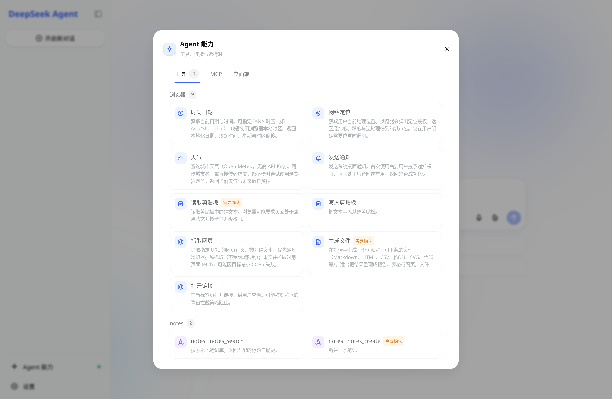

### 1. 浏览器内置工具

纯前端实现，部署后即可用，不依赖扩展或桌面端。

| 工具 | 作用 | 风险 |
| --- | --- | --- |
| `get_datetime` | 当前时间、时区换算、日期计算 | 只读 |
| `get_location` | 浏览器定位或设置里的手动位置 | 只读 |
| `get_weather` | 按城市或坐标取实况与预报 | 只读 |
| `send_notification` | 系统通知 | 只读 |
| `read_clipboard` / `write_clipboard` | 读写剪贴板 | 读 / 写 |
| `fetch_webpage` | 抓取网页正文（受 CORS 限制，拦截本机与内网地址） | 网络 |
| `create_file` | 生成可预览、可下载的文件产物（IndexedDB） | 写 |
| `preview_file` | 在回答底部内联预览代码、Markdown、HTML、CSV | 只读 |
| `view_image` | 把图片缩到模型可接受的长边后回传 | 只读 |
| `open_url` | 在公网地址上新开标签页 | 网络 |

另有 26 个从 one_cedric 移植的纯浏览器工具，覆盖日常计算与文本处理：

| 分组 | 工具 |
| --- | --- |
| 计算与随机 | `calculate` `random_number` `random_bytes` `password_gen` |
| 编码与哈希 | `base64_codec` `url_codec` `hash_text` `jwt_decode` |
| JSON / CSV | `json_format` `json_query` `json_diff` `csv_to_json` `json_to_csv` |
| 文本 | `text_stats` `word_frequency` `dedupe_lines` `strip_invisible` `regex_extract` `text_similarity` `markdown_toc` `template_render` `diff_text` |
| 时间 | `date_calc` `timezone_convert` `cron_next` |
| 其他 | `qrcode_generate` |

工具结果超过阈值会截断，避免长文档占满上下文。

### 2. 子 Agent

`spawn_subagent` 让主 Agent 把独立任务拆出去：子 Agent 有独立上下文与工具循环，默认只授予**只读工具**，不会触发审批，也不会把中间过程塞回主对话。

- 适合：分别调研多个对象再对比、先查证再汇总、把长链路检索拆出去
- 不适合：一步能完成的事、需要用户确认的写操作、需要保留中间截图的任务
- 最多 6 轮，结论超过 6000 字符会截断；子 Agent 不能再派生子 Agent

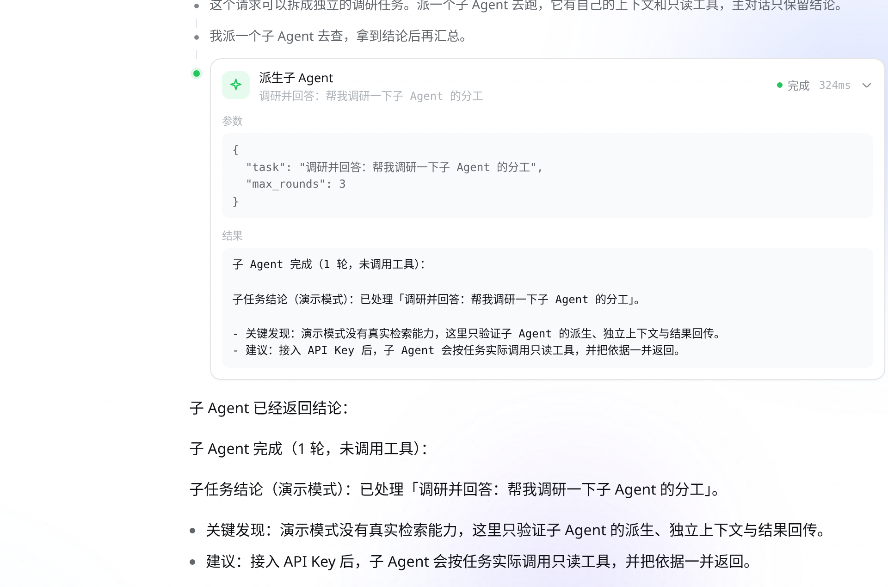

### 3. 主动提问（ask_user）

模型拿不准时不必猜：调用 `ask_user` 会挂起本轮，在输入框上方弹出问题卡片，回答后作为工具结果回到同一次推理里继续。

- 单选点一下即提交，多选勾选后统一确认，也可以直接输入自定义答案
- 快捷键：`1-9` 选选项、`Enter` 提交、`Esc` 跳过；跳过后模型按最合理的默认假设继续，并说明用了什么假设
- 工具调用不会超时，只有用户回答、手动跳过或点停止才结束；`ask_user` 不暴露给子 Agent，避免后台任务卡在提问上


回答会写回工具卡片，模型据此接着往下做：

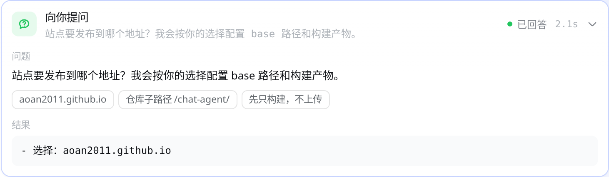

### 4. 工作区、分支与 diff

侧栏「工作区」或 `Ctrl/Cmd + Shift + E` 打开。默认载入内置演示仓库 `deepseek-agent`，三条分支各带未提交改动：

- `main`：并行工具执行、新增 `diff.ts`、补 README
- `feat/workspace`：新增工作区读取、时间线 diff 徽标、主题改动
- `fix/tool-timeout`：工具超时中断与回归测试

分支下拉可以切换，也可以新建（以当前工作树为基线，因此新分支 diff 为空）。切换后基线与文件树整组替换，观感与 `git checkout` 一致。

点任一文件，右侧用 Monaco DiffEditor 打开：**删除行红底、新增行绿底**，顶部实时显示 `+N −M`，可切「并排 / 行内」。Monaco 按需加载，首屏不为它买单。

「打开文件夹」走 File System Access API 读取本地目录（Chromium 系），并解析 `.git/HEAD`、`refs/heads` 与 `packed-refs` 得到分支列表。本地模式以**打开时的快照**为基线，用来看自己刚才改了什么；它不会替你执行 `git checkout`，也不会改写 `.git`。

Agent 侧配套五个工具：`workspace_list_files`、`workspace_read_file`、`workspace_write_file`、`workspace_switch_branch`、`workspace_diff`。写文件与切分支默认走审批，落盘或切换后 diff 立刻刷新。

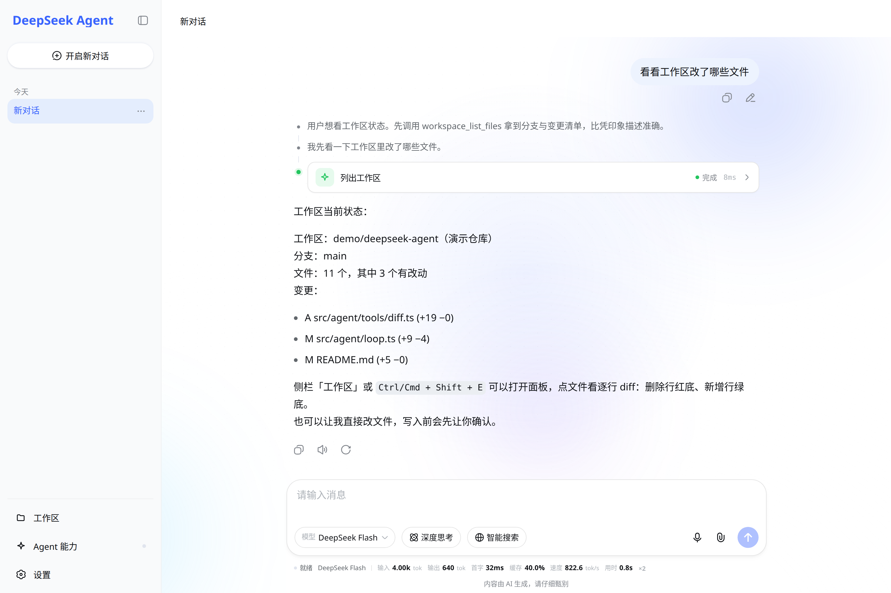

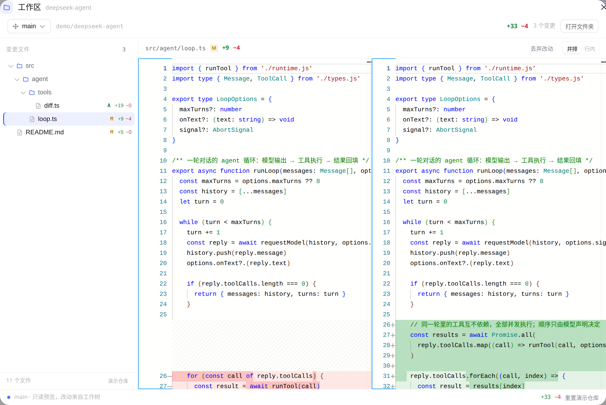

切换分支与新建分支：

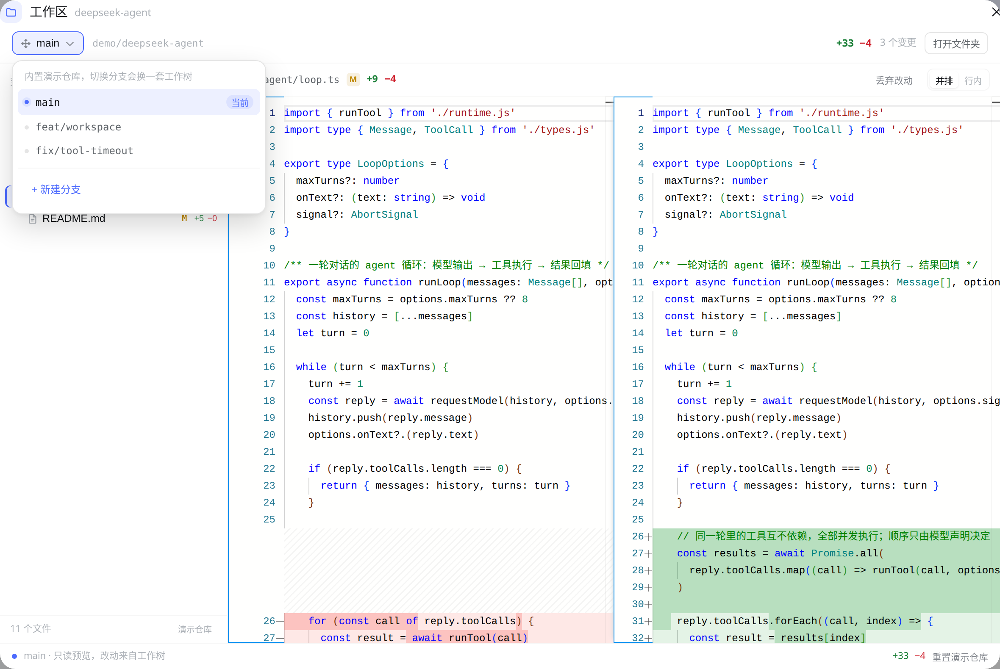

深色主题：

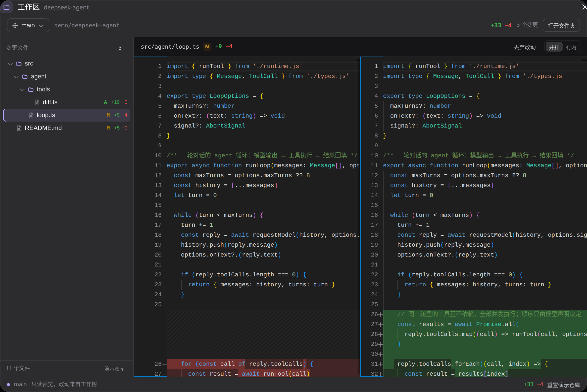

### 5. 可视化组件

`show_widget` 由模型自行决定何时使用：传入 HTML，运行时存成 widget 产物，消息里用沙箱 iframe 直接渲染。脚本被隔离，无法访问聊天页面的数据；卡片可以展开到全屏，也可以下载成独立 HTML 文件。

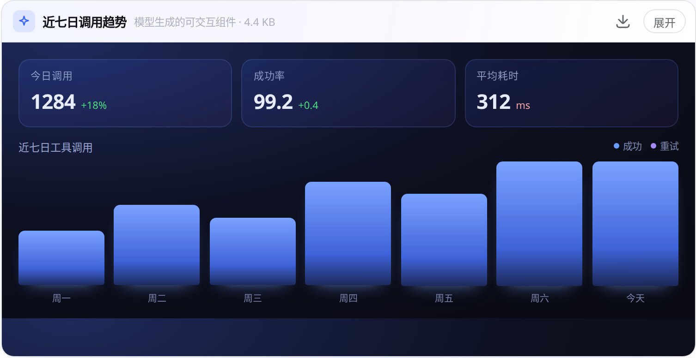

### 6. 桌面端（Python + rich）

把本机能力通过 WebSocket 暴露给网页，自带 rich 终端面板。

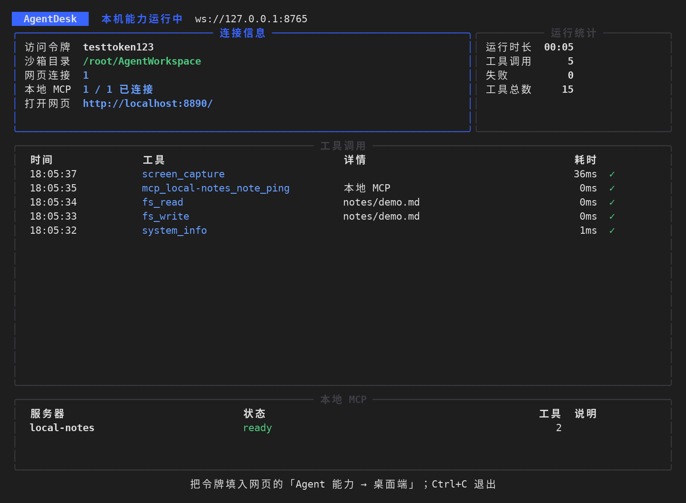

```sh
cd desktop
pip install -r requirements.txt
python -m agentdesk                       # 默认 127.0.0.1:8765
python -m agentdesk --sandbox ~/Work      # 指定工作目录
python -m agentdesk --allow-path ~/notes  # 额外放行的目录，可重复
python -m agentdesk --serve-web ../dist   # 同时托管构建产物
```

沙箱之外默认只放行 `~/.skills`，Agent 用绝对路径或 `~/` 开头的路径就能直接读技能说明与脚本，其余目录仍然越界报错。

启动后终端会显示**访问令牌**，把它填到网页的 **Agent 能力 → 桌面端** 即可连接。也可以直接用带参数的地址打开：

```text
http://localhost:8090/?desktop=ws%3A//127.0.0.1%3A8765&token=<令牌>
```

提供 48 个本机工具，连接后工具面板会出现独立的「本机桌面端」分组。

文件与执行（9 个）：`desk_fs_read`、`desk_fs_list`、`desk_fs_stat`、`desk_fs_write`、`desk_fs_delete`、`desk_fs_move`、`desk_shell_exec`、`desk_python_exec`、`desk_system_info`。

数据与诊断（16 个，参考 one-cedric3 移植）：

| 工具 | 作用 |
| --- | --- |
| `desk_hash` | md5/sha1/sha256/sha512、base64 编解码、生成 uuid |
| `desk_grep` | 沙箱内按正则搜内容，返回文件:行号，自动跳过二进制与大目录 |
| `desk_archive` | zip 列表 / 解压 / 打包，解压时拦截 `../` 路径穿越 |
| `desk_json_query` | 点号路径取值，例如 `data.items.0.name` |
| `desk_json` | JSON 美化 / 压缩 / 校验 / 两份对比 |
| `desk_text` | 词频、行去重、清不可见字符、`{{变量}}` 模板渲染 |
| `desk_cron` | 5 段 cron 接下来几次执行时间 |
| `desk_system` | 运行环境、CPU/内存/磁盘快照、指定路径磁盘占用 |
| `desk_http` | GET/POST 等请求，只允许公网地址并校验跳转 |
| `desk_replace` | 批量查找替换，默认只预览，确认后才写回 |
| `desk_net_probe` | HTTP 状态码与耗时、DNS 解析、TCP 端口连通性 |
| `desk_process_list` | 进程占用排行，有 psutil 时更准 |
| `desk_text_stats` | 行数、字符数、词数、字节与估算 token |
| `desk_clipboard` | 读写系统剪贴板（读需要确认） |
| `desk_git` | 只读 git 查询：status / log / diff / branch / show |
| `desk_workspace` | 列出 / 切换本机工作区；额外目录写在 `~/.agentdesk/config.json` 的 `workspaces` 或 `AGENTDESK_WORKSPACES` 里，`--sandbox` 指定的目录始终在列表最前 |

**工作区跟随**：网页端选择器显示的始终是桌面端的当前工作区——桌面端重启换了 `--sandbox`、或在别处调用了 `desk_workspace use`，选择器会自动跟上；桌面端掉线时页面会清掉旧快照并按退避自动重连，恢复后无需重选。`--sandbox` 指定的目录（包括 `.agentworkspace` 这类隐藏目录）现在也会出现在列表里，不会再一直显示旧的默认目录。

检索与格式（19 个）：`desk_glob`、`desk_diff`、`desk_calculate`、`desk_time`、`desk_regex`、`desk_codec`、`desk_csv`、`desk_sqlite`、`desk_tree`、`desk_dupes`、`desk_download`、`desk_net`、`desk_password`、`desk_markdown`、`desk_similarity`、`desk_pdf`、`desk_image`、`desk_qr`、`desk_office`。

电脑操作（4 个）：

| 工具 | 作用 | 依赖 |
| --- | --- | --- |
| `desk_screen_capture` | 截取整个屏幕，返回 PNG 并落成图片产物 | Linux 需要 ImageMagick 或 scrot |
| `desk_mouse` | 移动鼠标、左/右/中键点击，坐标与截图一致 | Linux 需要 xdotool |
| `desk_keyboard` | 输入文本（中文走剪贴板）、发送 `ctrl+s` 这类组合键 | macOS 需要辅助功能权限 |
| `desk_window` | 列出可见窗口、按标题聚焦 | Linux 需要窗口管理器 |

> 电脑操作会直接接管鼠标键盘，默认都要审批。先在 **系统设置 → 隐私与安全** 里给终端授予辅助功能 / 屏幕录制权限；Wayland 会话下 xdotool 无法工作，需要切换到 X11。

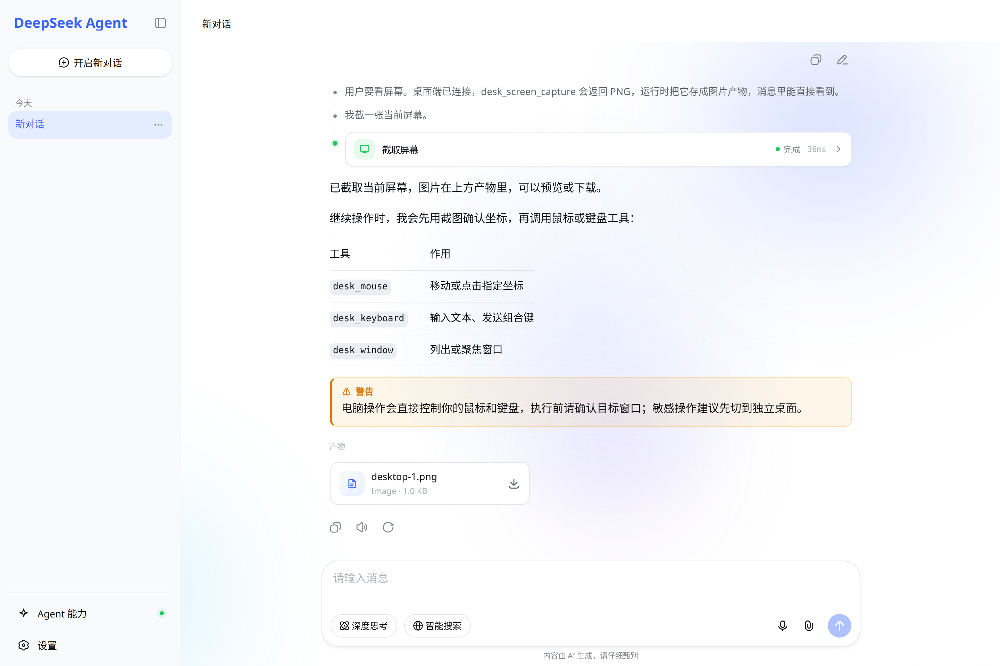


<table>
<tr>
<td width="52%">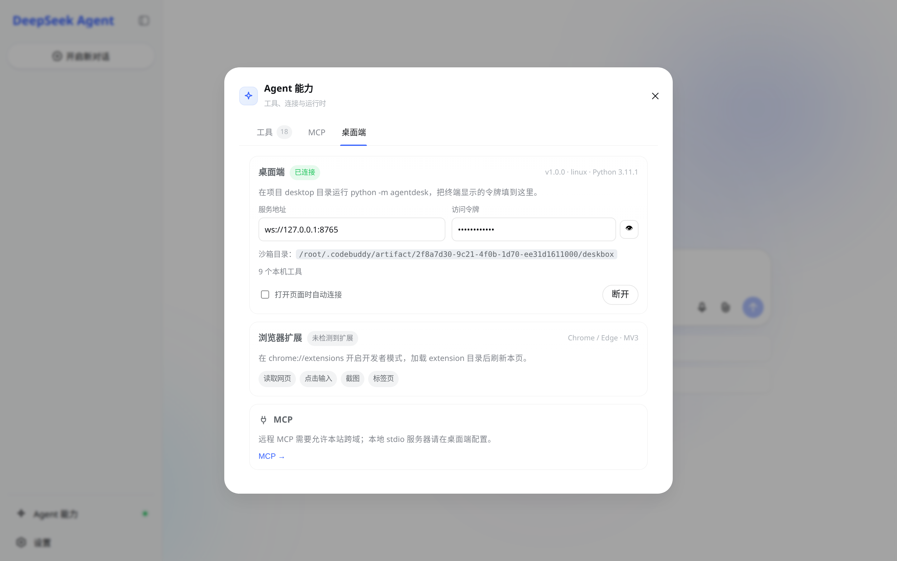</td>
<td width="48%">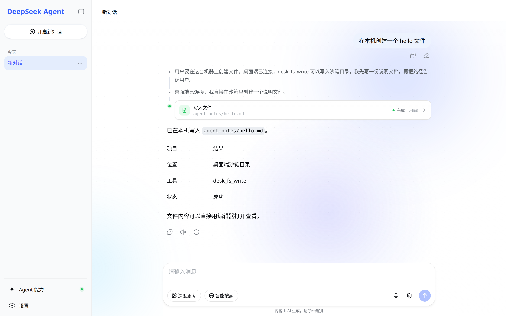</td>
</tr>
<tr>
<td align="center">填入令牌后显示版本、沙箱与工具数</td>
<td align="center">审批通过后由桌面端真实写入本机</td>
</tr>
</table>

安全边界：

- 所有路径解析后必须落在 `--sandbox` 目录内，越界直接拒绝
- 令牌随机生成，保存在 `~/.agentdesk/config.json`（权限 0600）
- WebSocket 校验来源，默认只允许 `localhost`、`127.0.0.1`、`*.github.io` 与 `file://`
- `--no-shell` 可整体禁用命令与 Python 执行

本地 MCP 服务器支持 Claude Desktop 风格的 `mcp.json`，放在项目根目录或 `~/.agentdesk/mcp.json`：

```json
{
  "mcpServers": {
    "filesystem": { "command": "npx", "args": ["-y", "@modelcontextprotocol/server-filesystem", "/path"] },
    "github": { "command": "npx", "args": ["-y", "@modelcontextprotocol/server-github"], "env": { "GITHUB_TOKEN": "..." } }
  }
}
```

桌面端会拉起这些进程，并把它们的工具以 `desk_mcp_*` 前缀暴露给网页。

### 7. 浏览器扩展

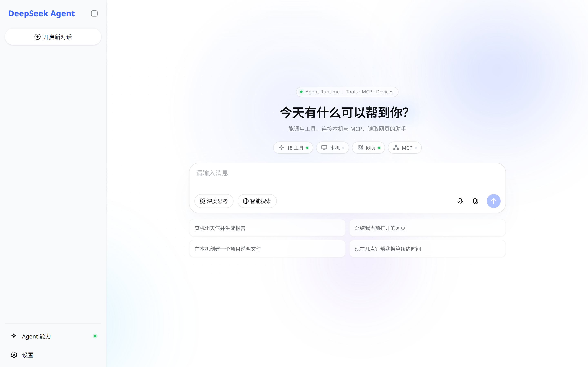

```sh
# 打包产物在 dist-ext/
cd extension && zip -qr ../dist-ext/deepseek-agent-bridge-1.0.0.zip .

# 签名 CRX：Chrome 会在 extension/ 的上级目录生成 extension.crx，重命名归档即可
# 私钥 dist-ext/agent-bridge.pem 只留在本地，不提交
google-chrome --pack-extension=extension --pack-extension-key=dist-ext/agent-bridge.pem
```

仓库的 `dist-ext/` 下已放好 zip 与 crx。安装方式：

1. **推荐**：打开 `chrome://extensions`，开启右上角**开发者模式**，点击**加载已解压的扩展程序**，选择 `extension/` 目录
2. 刷新 Agent 页面，侧栏「Agent 能力 → 浏览器扩展」显示已连接
3. `dist-ext/deepseek-agent-bridge-1.0.0.crx` 可用于企业策略分发或 Chromium 命令行安装（`--load-extension` 仍指向解压目录）；桌面版 Chrome 已禁止直接拖入非商店 crx

提供读取正文、后台抓取、点击、输入、滚动、截图、标签页管理、跳转与批量提取共 9 个工具。默认操作**用户最近查看的网页**并排除 Agent 页面自身，也可以用 `tab_id` 精确指定。

细节见 [`extension/README.md`](extension/README.md)。

### 8. MCP 远程服务器

在 **Agent 能力 → MCP → 添加服务器** 填入地址，支持两种传输：

- **Streamable HTTP**：POST JSON-RPC，兼容 `Mcp-Session-Id`
- **SSE**：旧的 `/sse` + `/message` 双端点模式

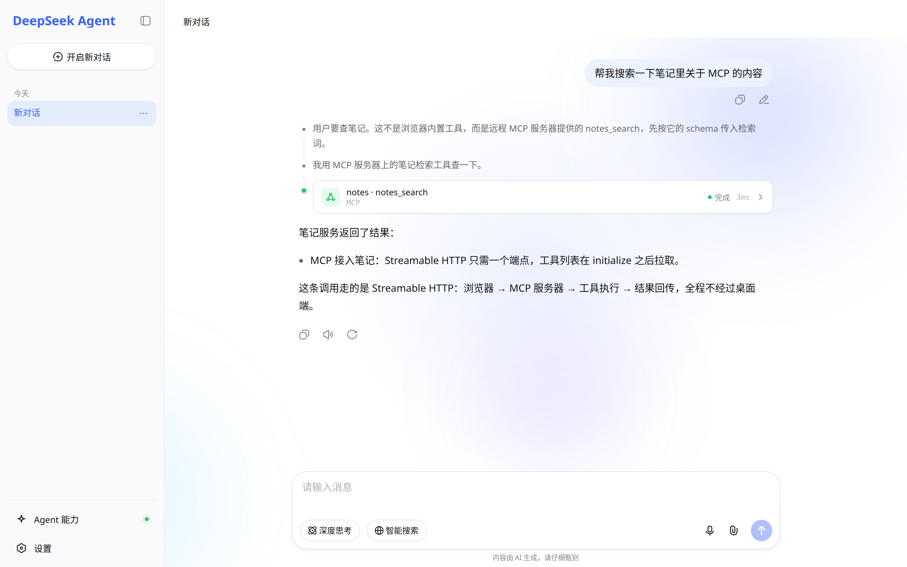

连接成功后，服务器提供的工具会带上服务器前缀注册进同一张工具表，模型可以像调用内置工具一样调用它们，例如 `notes · notes_search`。

远程服务器必须允许当前站点跨域（`Access-Control-Allow-Origin`）。浏览器无法直连 stdio 服务器，这类服务器请交给桌面端桥接。

> 客户端不会在每个请求上重复 `MCP-Protocol-Version` 头：它会触发跨域预检，而很多服务器没有在 `Access-Control-Allow-Headers` 里放行。协议版本在 `initialize` 的 body 中声明，服务端据此协商。

## 实时反馈与思考强度

**底部状态条**每 1 秒刷新一次，展示本轮请求的输入 / 输出 token、首字延迟、缓存命中率、生成速度与总用时；数字变化时会先模糊、轻轻上跳再落位。工具循环的每一轮会累加到同一条记录，`×2` 表示本轮已经走了两次模型请求。


**流式文字**按字符入场：新到的字先高度模糊、从偏下位置上浮，越过基线后回弹一次。中文逐字、英文按词分组，避免把单词拆断；动画只作用于末尾一小段文本，长回答也不会拖慢渲染。


**模型选择**在输入框底部：收起时只显示模型名与当前等级，点开后第一行是模型（点右侧箭头进入模型列表，底部「从远端拉取」会请求 `/models` 并缓存一小时；接口不可达或没有 Key 时自动使用内置列表），下方是推理等级卡片。

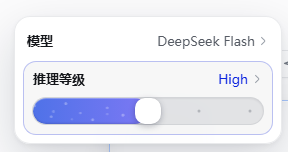

**思考强度**有 0-4 五档：关闭 / Low / High / Max / Ultra，全部收在同一个面板里。卡片里是一条厚胶囊滑杆：拖动时指数阻尼跟手、松手吸附到最近档位并轻微过冲回弹；渐变色逐档偏紫——Low 是纯蓝、Ultra 是深紫；未到达的档位用小圆点标出，高档位还会浮出向左漂移、明暗闪烁的白色光点。拖到最高档时，标题行会短暂变成「更快消耗使用额度」，约 1.5 秒后淡回「推理等级 Ultra」，卡片边框则保持亮起。档位会真实写进请求：

```json
{
  "thinking": { "type": "enabled", "budget_tokens": 32000 },
  "reasoning_effort": "max"
}
```

服务端若不认识这两个字段并返回 400，客户端会自动去掉强度参数、退回普通的 `thinking: { type: "enabled" }` 重试一次，对话不会因此中断。

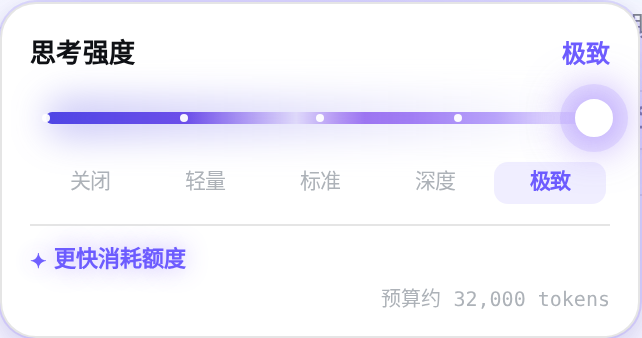

## Markdown 扩展语法

除标准 GFM 外，渲染器还支持三种写法，浅色与深色模式分别调过色：

| 语法 | 效果 | 说明 |
| --- | --- | --- |
| `==文本==` | 黄色打底高亮 | 默认色 |
| `==red:文本==` | 红色打底 | 另有 green / blue / purple / orange / pink / gray / cyan |
| `~文本~` | 手写波浪下划线 | 双波浪 `~~文本~~` 仍是删除线 |
| `> [!NOTE]` | 蓝色提示块 | 另有 TIP / IMPORTANT / WARNING / CAUTION |

```md
==yellow:默认高亮==、==red:红色==、==green:绿色==、==blue:蓝色==、==purple:紫色==

这句话有 ~手写波浪线~ 和 ==orange:橙色高亮==。

> [!IMPORTANT]
> 部署前先跑 `pnpm type` 与 `pnpm lint`。
```

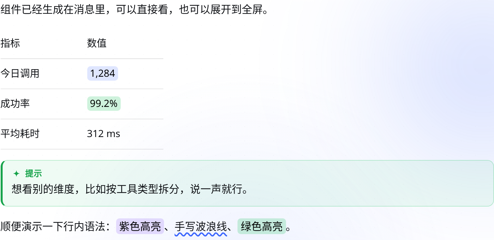

解析在 `src/services/markdown/parse.ts` 完成：高亮与波浪线在文本节点上换成自定义节点，alert 则把引用块首行的标记摘掉再改节点类型，渲染器不必回读原文。

## 用量与预算

侧栏底部新增一张用量卡片，参考 DeepSeek 控制台的额度样式：预算进度条、今日花费占比、今日 tokens 与模型数、当前时段（高峰 / 空闲 / 周末 / 节假日）以及下一次切换的倒计时，最下面是 API Key 登录状态。点击「官网价」可直接打开官方价目表。

金额按 DeepSeek 官网价估算（人民币 / 百万 tokens）：

| 模型 | 缓存命中（空闲 / 高峰） | 缓存未命中（空闲 / 高峰） | 输出（空闲 / 高峰） |
| --- | --- | --- | --- |
| `deepseek-flash` | ¥0.02 / ¥0.04 | ¥1 / ¥2 | ¥4 / ¥8 |
| `deepseek-v4-pro` | ¥0.15 / ¥0.30 | ¥4.5 / ¥9 | ¥13.5 / ¥27 |

高峰时段为北京时间周一至周五 9:00-12:00、14:00-18:00（法定节假日除外），其余时间与周末全天为空闲价。价格以[官方价目表](https://api-docs.deepseek.com/zh-cn/quick_start/pricing/)为准；本地账本只保存 token 数与估算金额，不记录对话内容，预算在「设置 → 通用 → 用量与预算」里修改或清空。

## 安全模型

| 层 | 措施 |
| --- | --- |
| 模型 | 工具声明带来源与风险等级，写/执行类默认要求审批 |
| 界面 | 审批弹窗展示参数摘要，长文本截断；可「允许一次」或「本会话内允许」 |
| 网络 | 抓取网页、查看远程图片与新开链接只允许公网 http(s)，拦截 localhost、内网段与云元数据地址（防 SSRF） |
| 渲染 | Mermaid 以 `securityLevel: strict` 渲染，注入前再净化一次 SVG（去脚本、事件属性与 `javascript:` 链接）；KaTeX / Prism 输出走受控 HTML |
| 链接 | 所有 `target="_blank"` 链接都带 `noopener noreferrer`；页面声明 `referrer` 策略 |
| 内容策略 | `index.html` 设置最小 CSP：`object-src 'none'`、`base-uri 'self'`、`form-action 'none'` |
| 扩展桥 | `postMessage` 只发往同源窗口并校验 `event.origin`，不再使用 `'*'` |
| 桌面端 | 目录沙箱 + 令牌 + Origin 校验；越界路径在工具层直接拒绝 |
| 扩展 | 不主动上传数据；仅在 Agent 调用时读取当前标签页 |
| 数据 | API Key 与会话都在本地，产物存 IndexedDB，不经过第三方服务器 |

**审批不能替代沙箱。** 桌面端的目录限制在工具实现内部强制执行，即使模型被诱导也无法读写沙箱外的文件（命令执行除外——`desk_shell_exec` 的能力边界就是 shell 本身，请谨慎授予）。

## 目录结构

```text
src/
  components/agent/      工具卡片、产物卡片、组件卡片、审批弹窗、提问面板、能力面板
  components/workspace/  工作区面板、文件树、Monaco diff 预览
  components/chatInput/  输入框、模型选择、思考强度轨道、实时状态条
  components/messages/   消息流与右侧问题导航（QuestionNav）
  components/markdown/   自定义节点渲染（高亮、波浪线、alert、逐字入场）
  services/agent/
    tools/               浏览器内置工具、widget、子 Agent 入口、ask_user、workspace
    subagent.ts          子 Agent 运行器
    mcp/                 MCP 客户端与会话管理
    desktop/             桌面端 WebSocket 客户端
    runtime.ts           工具执行、审批、超时与结果落库
    userPrompt.ts        提问的挂起、回答与跳过
    registry.ts          工具注册表
    artifacts.ts         产物读写与下载
    mock.ts              演示模型
  services/workspace/    工作区状态、演示仓库、.git 解析、diff 统计、Monaco 装载
  services/api/models.ts 远端模型列表与缓存
  services/chat/liveStats.ts  实时用量、首字与速度统计
  services/markdown/     GFM 解析与自定义语法
desktop/                 Python 桌面端
  agentdesk/             config / sandbox / tools / computer / server / tui / mcp_bridge
  tools/                 文档截图辅助脚本
extension/               MV3 浏览器扩展
docs/screenshots/        文档配图
```

## 开发

| 命令 | 用途 |
| --- | --- |
| `pnpm dev` | 开发服务器 |
| `pnpm build` | 构建到 `dist/` |
| `pnpm type` | TypeScript 类型检查 |
| `pnpm lint` | oxlint 检查 |
| `pnpm format` | oxfmt 格式化 |

桌面端测试（pytest）：

```sh
cd desktop
python -m pip install -r requirements.txt -r requirements-dev.txt
python -m pytest -q
```

`.github/workflows/ci.yml` 跑三组任务：网页端类型检查 + lint + 构建；桌面端在 Ubuntu / macOS / Windows × Python 3.9 / 3.11 / 3.13 上跑 pytest；以及校验词表资源存在。

重新生成词表（需要 DeepSeek 的 `tokenizer.json`）：

```sh
node scripts/build-tokenizer.mjs /path/to/tokenizer.json
```

## 已知限制

- 远程 MCP 受浏览器 CORS 限制，服务器需要显式放行站点来源
- 模型列表通过 `/models` 拉取，同样受 CORS 限制；不可达时使用内置的 deepseek-flash / deepseek-v4-pro
- `reasoning_effort` 与 `budget_tokens` 是否生效取决于服务端；被拒绝时会自动降级为普通思考请求
- 扩展无法在 `chrome://`、扩展商店页、PDF 预览页注入
- 整页截图通过滚动拼接，最多 8 屏，受 `captureVisibleTab` 配额限制
- `desk_shell_exec` 在沙箱目录内启动进程，但进程本身可以访问沙箱外路径
- 电脑操作依赖系统权限：macOS 需要辅助功能与屏幕录制授权，Linux 需要 X11 与 xdotool，Wayland 下不可用
- 子 Agent 默认只授予只读工具，需要写操作时仍要回到主对话走审批
- `ask_user` 没有超时：切到别的会话后这一轮仍停在等待状态，回到该会话继续回答、或点停止才会释放
- 工作区本地模式依赖 File System Access API，只有 Chromium 系可用；分支列表只读，切换/新建只对演示仓库生效；本地 diff 以打开时的快照为基线，不是真实 HEAD 对比
- Monaco 的异步 chunk 约 2.7 MB（gzip 后约 700 KB），首次打开工作区会多等一会儿
- Widget 运行在无 same-origin 的沙箱 iframe 中，不能读写页面数据，也不能发网络请求之外的同源操作
- 演示模型只覆盖固定的几条剧本，用于验证链路而非真实推理

## 许可证

[MIT](LICENSE)。原项目版权归 DeepSeek 所有，改造部分同样以 MIT 发布。

## Star History

<a href="https://www.star-history.com/?repos=aoan2011%2Fdeepseek-agent&type=date&legend=top-left">
 <picture>
   <source media="(prefers-color-scheme: dark)" srcset="https://api.star-history.com/chart?repos=aoan2011/deepseek-agent&type=date&theme=dark&legend=top-left" />
   <source media="(prefers-color-scheme: light)" srcset="https://api.star-history.com/chart?repos=aoan2011/deepseek-agent&type=date&legend=top-left" />
   
 </picture>
</a>

## Contributors
<a href="https://github.com/Aoan2011/DeepSeek-Agent/graphs/contributors">
  
</a>

Made with [contrib.rocks](https://contrib.rocks).

## Buy me a coffee
